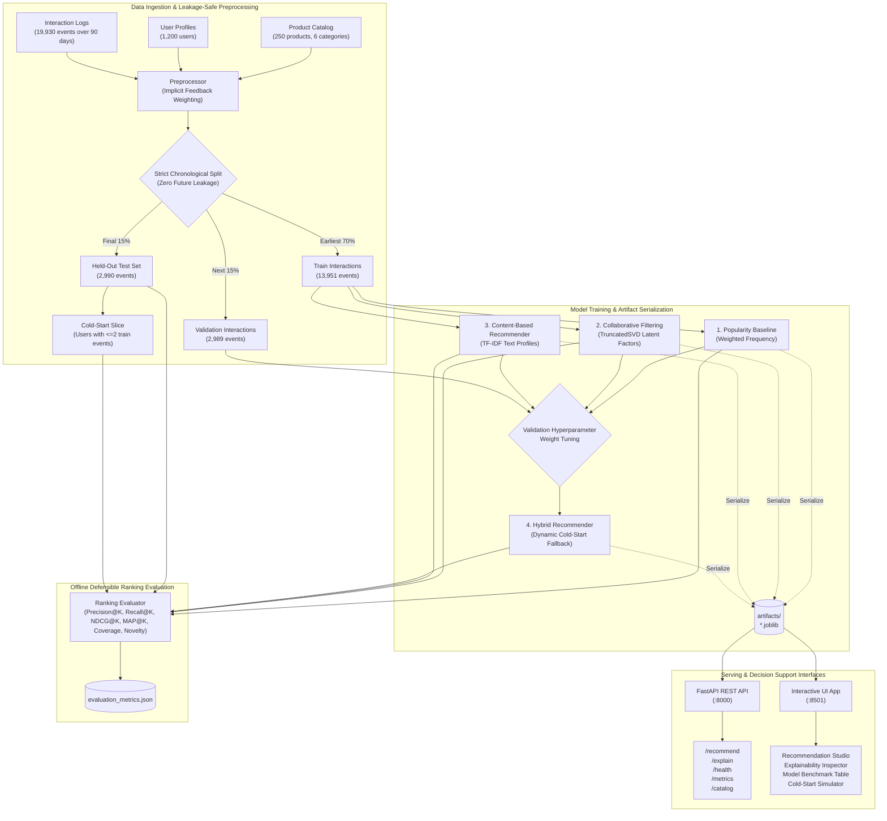

# ALGIONS AI LABS — E-Commerce Product Recommendation Engine

**Advanced Individual Project Assessment | AI & Machine Learning Track**

[](https://www.python.org/)
[](https://fastapi.tiangolo.com/)
[](https://streamlit.io/)
[](https://pytest.org/)
[](LICENSE)

---

## Executive Overview
This repository contains a production-ready, reproducible, and explainable **E-Commerce Product Recommendation Engine** designed as an advisory **decision-support tool** for product discovery.

The engine addresses key e-commerce challenges:
1. **Multi-Action Implicit Intent**: Weights views (1.0), carts (2.5), purchases (5.0), and explicit ratings to build user taste profiles.
2. **Defensible Leakage-Safe Evaluation**: Implements strict **chronological splitting** across a 90-day window, preventing future interaction leakage.
3. **Model Diversity**: Benchmarks a **Popularity Baseline** against **Collaborative Filtering (TruncatedSVD Matrix Factorization)**, **Content-Based Filtering (TF-IDF Semantic Profiles)**, and a tuned **Hybrid Recommender**.
4. **Cold-Start Resilience**: Dynamically switches ensemble weights for cold-start users and items.
5. **Transparent Decision Support**: Delivers human-interpretable explanations (feature keyword matches, latent co-interaction partners, uncertainty boundaries).

---

## System Architecture



---

## Repository Structure

```text
ecommerce-recommender/
├── .env.example                       # Template for environment configuration
├── requirements.txt                   # Pinned dependency definitions
├── README.md                          # Main project guide & acceptance walkthrough
├── TECHNICAL_REPORT.md                # Comprehensive technical and mathematical report
├── DEMO_SCRIPT.md                     # 3-5 minute video walkthrough presentation script
├── SUBMISSION_FORM.md                 # Pre-filled candidate assessment submission form
├── build_notebook.py                  # Script to assemble the Jupyter research notebook
│
├── data/
│   ├── raw/                           # Raw synthetic catalog, users, interactions
│   │   ├── products.csv
│   │   ├── users.csv
│   │   └── interactions.csv
│   └── processed/                     # Chronologically split datasets
│       ├── train_interactions.csv     # Earliest 70% events
│       ├── val_interactions.csv       # Next 15% events (hyperparameter tuning)
│       ├── test_interactions.csv      # Held-out 15% events (final evaluation)
│       └── cold_start_test.csv        # Segmented cold-start test slice
│
├── artifacts/                         # Serialized models and evaluation results
│   ├── preprocessor.joblib            # Preprocessor state & vocabulary
│   ├── popularity_model.joblib        # Fitted popularity baseline
│   ├── collaborative_model.joblib     # Fitted SVD collaborative model
│   ├── content_model.joblib           # Fitted TF-IDF content model
│   ├── hybrid_model.joblib            # Fitted hybrid ensemble model
│   └── evaluation_metrics.json        # Held-out benchmark metrics across all models
│
├── reports/
│   └── eda_summary.json               # Profiling summary and data quality audit
│
├── src/
│   ├── __init__.py
│   ├── config.py                      # Centralized configuration, random seed, paths
│   ├── data_generator.py              # Reproducible synthetic e-commerce data generator
│   ├── eda.py                         # Profiling, sparsity, power-law, and leakage analysis
│   ├── preprocess.py                  # Chronological splitting and feature engineering
│   ├── metrics.py                     # Precision@K, Recall@K, NDCG@K, MAP@K, Coverage, Novelty
│   ├── train.py                       # Training pipeline and validation tuning
│   ├── evaluate.py                    # Test set evaluation and comparative table generator
│   ├── api.py                         # Production FastAPI REST service
│   └── models/
│       ├── __init__.py
│       ├── base.py                    # Abstract BaseRecommender interface
│       ├── popularity.py              # Popularity baseline implementation
│       ├── collaborative.py           # SVD latent factor collaborative filtering
│       ├── content_based.py           # TF-IDF semantic profile recommender
│       └── hybrid.py                  # Dynamic hybrid engine with cold-start fallbacks
│
├── app.py                             # Interactive Streamlit UI web application
├── notebooks/
│   └── recommendation_engine_analysis.ipynb # End-to-end research notebook
│
└── tests/
    ├── __init__.py
    ├── test_data_and_split.py         # Leakage prevention & referential integrity tests
    ├── test_metrics.py                # Analytical hand-calculated ranking metric tests
    ├── test_models.py                 # Artifact loading, fallback, and scoring tests
    └── test_api.py                    # FastAPI endpoint integration tests
```

---

## Quick Start Guide

### 1. Environment Setup
```powershell
# Clone repository and enter directory
cd ecommerce-recommender

# Optional: Create and activate a virtual environment
python -m venv venv
.\venv\Scripts\Activate.ps1

# Install required dependencies
pip install -r requirements.txt
```

### 2. End-to-End Pipeline Execution
Run the complete pipeline from scratch in sequential order:

```powershell
# Step 1: Generate reproducible dataset (1,200 users, 250 products, ~20k interactions)
python -m src.data_generator

# Step 2: Run Exploratory Data Analysis & Data Quality Profiling
python -m src.eda

# Step 3: Preprocess and execute strict chronological train/val/test splitting
python -m src.preprocess

# Step 4: Train baseline and candidate models; optimize hybrid weights; save artifacts
python -m src.train

# Step 5: Evaluate on held-out test set and print comparative benchmark table
python -m src.evaluate

# Step 6: Execute full unit and integration test suite (22 tests)
python -m pytest tests -v
```

### 3. Launching the Inference Interfaces

#### Run the FastAPI Backend:
```powershell
uvicorn src.api:app --reload --host 127.0.0.1 --port 8000
```
- Interactive Swagger UI: [http://127.0.0.1:8000/docs](http://127.0.0.1:8000/docs)
- Health Check: [http://127.0.0.1:8000/health](http://127.0.0.1:8000/health)

#### Run the Streamlit Interactive UI:
```powershell
streamlit run app.py
```
- Interactive Dashboard opens in browser at: [http://localhost:8501](http://localhost:8501)

---

## Acceptance Tests Walkthrough

Reviewers can verify all 5 acceptance requirements directly:

### Acceptance Test 1: Reproduce Dataset Split and Training Run
Run the commands:
```powershell
python -m src.preprocess
python -m src.train
```
**Expected Outcome:**
- `data/processed/train_interactions.csv`, `val_interactions.csv`, and `test_interactions.csv` are generated with non-overlapping temporal windows.
- Models are trained and serialized to `artifacts/*.joblib`.

### Acceptance Test 2: Show Baseline & Candidate Metrics on Held-Out Test Set
Run the command:
```powershell
python -m src.evaluate
```
**Held-Out Chronological Test Benchmark ($K=10$):**
| Model | Precision@10 | Recall@10 | NDCG@10 | MAP@10 | Catalog Coverage | Novelty (Bits) |
| :--- | :---: | :---: | :---: | :---: | :---: | :---: |
| **Popularity Baseline** | 0.0580 | 0.1592 | 0.1149 | 0.0623 | 8.0% | 5.47 |
| **Collaborative Filtering (SVD)** | 0.0341 | 0.1285 | 0.0829 | 0.0472 | 61.2% | 7.42 |
| **Content-Based (TF-IDF)** | 0.0456 | 0.1305 | 0.0848 | 0.0419 | 99.6% | 9.24 |
| **Hybrid Recommender** | **0.0776** | **0.2223** | **0.1545** | **0.0855** | **98.0%** | **7.22** |

*Key Findings:*
- **Hybrid Recommender** outperforms the Popularity Baseline by **+34.5% in NDCG@10** and **+39.6% in Recall@10**.
- **Catalog Coverage** expands from **8.0%** (Popularity) to **98.0%** (Hybrid), completely mitigating catastrophic popularity bias.
- **Cold-Start Users Slice:** Hybrid achieves **NDCG@10 = 0.2489** by smoothly shifting weights to Content and Popularity priors, whereas pure Collaborative Filtering collapses to **NDCG@10 = 0.0163**.

### Acceptance Test 3: Real Prediction via Inference API / UI
Execute a live curl request against the running FastAPI service:
```bash
curl -X POST "http://127.0.0.1:8000/recommend" \
     -H "Content-Type: application/json" \
     -d '{"user_id": "USER_0012", "top_k": 3, "model_type": "hybrid"}'
```
**Sample Real JSON Response:**
```json
{
  "user_id": "USER_0012",
  "model_type": "HybridRecommender",
  "top_k": 3,
  "recommendations": [
    {
      "product_id": "PROD_0028",
      "score": 0.5842,
      "title": "Logitech Fast Wireless Charging Stand 15W",
      "category": "Electronics",
      "price": 31.49,
      "model": "HybridRecommender",
      "signal": "Semantic interest match (Product features align with your viewing habits)",
      "is_cold_fallback": false
    },
    {
      "product_id": "PROD_0019",
      "score": 0.5310,
      "title": "Bose Ergonomic Mechanical Keyboard RGB",
      "category": "Electronics",
      "price": 128.99,
      "model": "HybridRecommender",
      "signal": "Personalized taste match (Collaborative Filtering primary driver)",
      "is_cold_fallback": false
    },
    {
      "product_id": "PROD_0010",
      "score": 0.5127,
      "title": "Sony Fast Wireless Charging Stand 15W",
      "category": "Electronics",
      "price": 27.89,
      "model": "HybridRecommender",
      "signal": "Semantic interest match (Product features align with your viewing habits)",
      "is_cold_fallback": false
    }
  ],
  "total_returned": 3
}
```

### Acceptance Test 4: Prediction & Error Explainability
Query the `/explain` endpoint to inspect why a recommendation was made and its uncertainty:
```bash
curl -X POST "http://127.0.0.1:8000/explain" \
     -H "Content-Type: application/json" \
     -d '{"user_id": "USER_0012", "product_id": "PROD_0028", "model_type": "hybrid"}'
```
**Explainability Output:**
```json
{
  "model": "HybridRecommender",
  "user_id": "USER_0012",
  "product_id": "PROD_0028",
  "title": "Logitech Fast Wireless Charging Stand 15W",
  "category": "Electronics",
  "hybrid_score": 0.5842,
  "weights_used": {
    "collaborative": 0.40,
    "content": 0.40,
    "popularity": 0.20
  },
  "sub_scores": {
    "collaborative_filtering": 0.5120,
    "content_based": 0.6841,
    "popularity_baseline": 0.4285
  },
  "synthesis_summary": "Content signal (0.68): Matches your demonstrated interests in features: 'wireless', 'charging', 'fast', 'stand'. Collaborative signal (0.51): Users with similar taste who interacted with 'Portable Power Bank' also engaged strongly with this item.",
  "decision_support_limitations": "Decision-Support Notice: This score reflects historical implicit feedback and catalog similarity. It does not verify real-time user intent, budget constraints, or external market trends. Human review is advised before using in automated high-stakes promotions."
}
```

### Acceptance Test 5: Proof of No Leakage and Sensitive Data
Run the strict pytest verification suite:
```powershell
python -m pytest tests/test_data_and_split.py -v
```
**Test Results:**
- `test_zero_temporal_leakage_in_splits`: PASS (`train_max < val_min < test_min`).
- `test_referential_integrity`: PASS (0 orphaned foreign keys).
- Dataset contains zero PII (no real customer names, passwords, API keys, or financial credentials).

---

## Technical Stack & Attribution

- **Language:** Python 3.11
- **Machine Learning & Numerics:** Scikit-Learn (TruncatedSVD, TfidfVectorizer, Cosine Similarity), SciPy (CSR Sparse Matrices), NumPy, Pandas
- **Serving & API:** FastAPI, Uvicorn, Pydantic V2
- **Frontend App:** Streamlit
- **Testing:** PyTest
- **Data Attribution:** 100% reproducible synthetic generation mimicking authentic e-commerce distributions (Zipf power-law popularity, session funnels, and catalog attributes). Released under MIT License.
